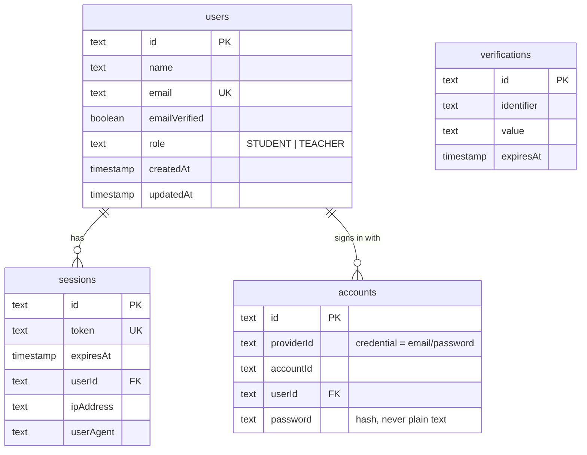

# Database

PostgreSQL 17, accessed through Prisma 7. The source of truth is
[`apps/server/prisma/schema.prisma`](../apps/server/prisma/schema.prisma); every change is a
migration in `apps/server/prisma/migrations/`. This document explains the structure and the
reasoning behind it. Tables are added module by module.

## Conventions

- **Table names** are plural snake_case (`users`, `sessions`) via `@@map`; Prisma models are singular PascalCase.
- **IDs** are strings generated by the application (better-auth generates user/session IDs).
- **Enumerations** (`role`, later meeting and game statuses) are `text` columns, narrowed by Zod schemas in `@app/shared`. better-auth has a known issue with Prisma enum fields, and plain strings keep migrations simple.
- **Timestamps** are `timestamp(3)` in UTC; `updatedAt` is maintained by Prisma.
- **Deletes cascade** from a user to their sessions and accounts.

## Diagram

## Tables

### Authentication (Module 1)

These four tables are the schema better-auth expects ([ADR 006](adr/006-better-auth.md)).

| Table | Purpose |
|---|---|
| `users` | One row per person. `role` is added by us as a better-auth *additional field* with `input: false`, so clients can never set it. |
| `sessions` | One row per signed-in browser. The cookie holds the session token; deleting the row signs that browser out immediately. |
| `accounts` | Sign-in methods per user. For email/password, `providerId = 'credential'` and `password` holds the hash. Kept separate from `users` so other providers (e.g. Google) could be added without schema changes. |
| `verifications` | Short-lived tokens (email verification, password reset). Unused for now; required by better-auth. |

Indexes: unique `users.email`, unique `sessions.token`, and `userId` on `sessions` and `accounts` for the per-user lookups better-auth performs.
