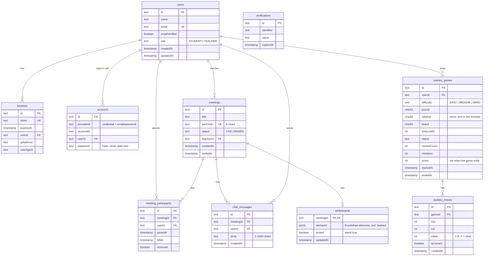

# Database

PostgreSQL 17, accessed through Prisma 7. The source of truth is
[`apps/server/prisma/schema.prisma`](../apps/server/prisma/schema.prisma); every change is a
migration in `apps/server/prisma/migrations/`. This document explains the structure and the
reasoning behind it. Tables are added module by module.

## Conventions

- **Table names** are plural snake_case (`users`, `sessions`) via `@@map`; Prisma models are singular PascalCase.
- **IDs** are strings: better-auth generates user/session IDs; our tables use `cuid()`.
- **Enumerations** (`role`, later meeting and game statuses) are `text` columns, narrowed by Zod schemas in `@app/shared`. better-auth has a known issue with Prisma enum fields, and plain strings keep migrations simple.
- **Timestamps** are `timestamp(3)` in UTC; `updatedAt` is maintained by Prisma.
- **Deletes cascade** from a user to their sessions, accounts, meetings, attendance and messages, and from a meeting to its attendance and messages.

## Diagram

## Tables

### Authentication (Module 1)

These four tables are the schema better-auth expects ([ADR 006](adr/006-better-auth.md)).

| Table | Purpose |
|---|---|
| `users` | One row per person. `role` is added by us as a better-auth *additional field* with `input: false`, so clients can never set it. |
| `sessions` | One row per signed-in browser. The cookie holds the session token; deleting the row signs that browser out immediately. |
| `accounts` | Sign-in methods per user. For email/password, `providerId = 'credential'` and `password` holds the hash. Kept separate from `users` so other providers (e.g. Google) could be added without schema changes. |
| `verifications` | Short-lived tokens (email verification, password reset). Unused for now; required by better-auth. |

Indexes: unique `users.email`, unique `sessions.token`, and `userId` on `sessions` and `accounts` for the per-user lookups better-auth performs.

### Meetings and chat (Module 2)

| Table | Purpose |
|---|---|
| `meetings` | A live class started by a teacher. `joinCode` is 6 characters from an alphabet without look-alikes (no 0/O, 1/I); a unique index guarantees no two meetings share one, and creation retries on the rare collision. `status` moves from `LIVE` to `ENDED` once, with `endedAt` set. |
| `meeting_participants` | Attendance and access in one row per user per meeting (unique `(meetingId, userId)`). `joinedAt` is the first join; `leftAt` is set when the user's last connection leaves and cleared on rejoin. `removed = true` is how a teacher's removal is enforced: such users get no LiveKit token, cannot enter the socket room, read history or send chat. |
| `chat_messages` | Persisted chat. Saved before being broadcast, with the server's timestamp. |

Indexes: `meetings(status)` for the live-meetings list, `meetings(teacherId)` for a teacher's past meetings, `meeting_participants(userId)`, and `chat_messages(meetingId, createdAt)`, which serves the paged history query (newest first, cursor by message id).

**Not stored:** who is connected to the video call right now, and their microphone/camera state. LiveKit already tracks that in real time; copying it would create a second source of truth that could disagree.

### Whiteboard (Module 3)

| Table | Purpose |
|---|---|
| `whiteboards` | One board per meeting, keyed by `meetingId`. `elements` is a JSON array of Excalidraw elements. Deleted shapes are kept with `isDeleted: true` (tombstones), so an older copy held by another browser can never bring them back. `locked` starts `true`: students can only watch until the teacher unlocks the board. |

**Why one JSON column instead of a row per shape?** The board is always read and written as a whole: loaded once when it is first opened, then kept in the server's memory while in use and saved in the background (every ~2 s if it changed, and on shutdown). Nothing ever queries individual shapes, and a row per shape would turn every save into hundreds of upserts. The merge rule (higher `version` wins, ties broken by the lower `versionNonce`) runs in memory, not in SQL.

**Trade-off:** a server crash loses at most the last ~2 seconds of drawing. Boards in memory are per process, so several API servers would need a shared store (e.g. Redis) or one owner per meeting.

### Sudoku and reports (Module 4)

| Table | Purpose |
|---|---|
| `sudoku_games` | One timed game. Grids are 81-character strings, row by row, `0` for empty. `solution` stays on the server; every move is checked against it there. When the game ends, `status`, `endedAt` and `score` are written once. **A finished game is its report**: a separate reports table would only copy these columns. |
| `sudoku_moves` | Every value placed, in order, with whether it was correct: the audit trail, and enough to replay a game. A `value` of 0 is clearing a wrong entry. |

Indexes: `sudoku_games(userId, endedAt)` for "my reports, newest first" and the teacher's table, and `sudoku_moves(gameId, createdAt)` for replaying a game in order.

**At most one game in progress per user**, enforced by a *partial* unique index: `UNIQUE (userId) WHERE status = 'IN_PROGRESS'`. Finished games don't count, so a user can have any number of those. Prisma's schema language can't express a partial index, so it is written by hand at the end of the migration's SQL (Prisma ignores it rather than treating it as drift). Two "start game" requests at the same moment cannot both succeed.

**Concurrent moves.** Each move locks its game row (`SELECT … FOR UPDATE`) inside a transaction, so two quick moves on the same game run one after the other and the second sees the first one's counts. Otherwise both could read "4 mistakes" and both write 5.

**Time.** The deadline is `startedAt + timeLimitS`, decided by the server. A game whose time ran out is finalized as `TIMED_OUT` (ending at its deadline) the next time anything touches it, including a teacher opening the reports list, so games left open in a closed tab still appear in reports.
